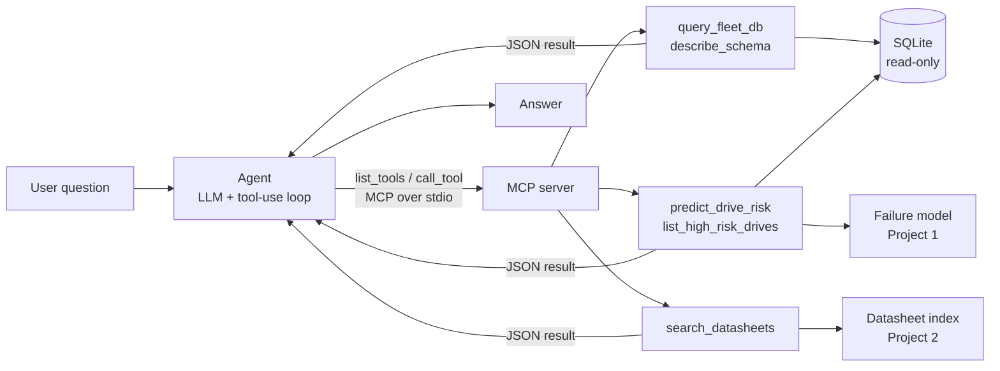

# Architecture

## Flow of one request
1. `FleetAgent` starts `python -m drivefleet.mcp_server.server` as a subprocess and opens an MCP session.
2. It calls `list_tools` and converts the schemas to Anthropic tool format. Tool **descriptions** are the
   routing signal; the model reads them to decide which tool fits.
3. Loop (max `DRIVEFLEET_MAX_AGENT_STEPS`): model replies -> if it requests tools, the agent runs them through
   `session.call_tool`, returns results as `tool_result` blocks (errors flagged `is_error`) -> repeat until a text answer.
4. The agent returns the answer plus the full tool-call trace (used by the evaluation).

## Design decisions
* **MCP, not in-process functions**: the same tools work in Claude Desktop/Code and can be tested independently.
* **Errors are data**: tools return `{"error": ...}` so the model can repair a bad query.
* **Warranty is deliberately absent from `list_high_risk_drives`**: combining prediction with SQL is the multi-tool behaviour under test.
* **Ground truth computed, not hard-coded**: the eval stays valid when data changes.
* **Defence in depth for SQL**: validation + read-only connection + authorizer + limits.
